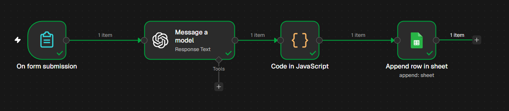
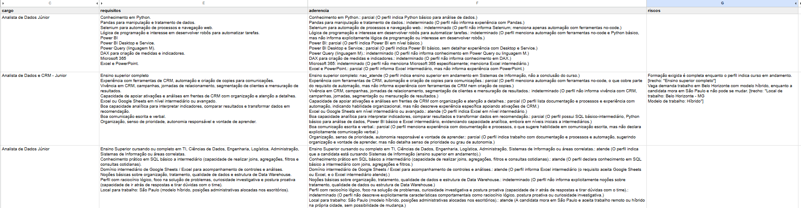

# Triagem de vagas com IA (n8n + LLM)

Fluxo de automação que recebe o texto de uma vaga, pede a um modelo de linguagem uma análise estruturada e grava o resultado em uma planilha do Google Sheets.

## O problema

Ao comparar várias vagas, o trabalho se repete: ler o anúncio, separar requisitos de diferenciais, comparar com o próprio perfil e anotar tudo de forma organizada. Este projeto automatiza essa primeira leitura e deixa o resultado em uma tabela fácil de comparar.

## O que o fluxo faz

```
Formulário  →  IA (análise da vaga)  →  Tratamento do JSON  →  Planilha
```

1. Um formulário do n8n recebe o texto da vaga e o link.
2. O modelo analisa a vaga e responde em JSON, comparando os requisitos com um **perfil fictício** (sem dados pessoais) definido no prompt.
3. Um nó de código converte o JSON em colunas de texto.
4. Uma linha é adicionada na planilha, com: empresa, cargo, resumo, requisitos, aderência (por requisito, com justificativa), riscos (com o trecho da vaga), observações, local/modelo de trabalho e diferenciais.

O resultado é um ponto de partida para a leitura da vaga. A decisão de se candidatar continua sendo humana, e a análise da IA precisa ser conferida contra o anúncio.

## Imagens





## Nós do fluxo

| Nó | Função |
|---|---|
| On form submission | Recebe o texto e o link da vaga |
| Message a model (GPT-5 mini) | Envia o prompt e a vaga ao modelo |
| Code in JavaScript | Remove marcações de código, valida o JSON e monta as colunas |
| Append row in sheet | Grava a linha no Google Sheets |

## Como reproduzir

1. Crie uma conta no [n8n](https://n8n.io) (a versão cloud tem período de teste).
2. Crie uma planilha no Google Sheets com estas 11 colunas na primeira linha, exatamente com estes nomes:
   `data`, `empresa`, `cargo`, `resumo`, `requisitos`, `aderencia`, `riscos`, `observacoes`, `link`, `local_modelo`, `diferenciais`
3. No n8n, importe o arquivo [`workflow/fluxo-v2.json`](workflow/fluxo-v2.json).
4. Crie as credenciais da OpenAI (chave de API) e do Google Sheets, e selecione-as nos nós correspondentes.
5. No nó do Google Sheets, selecione a sua planilha (o arquivo vem com um marcador no lugar do ID).
6. Abra o formulário, cole uma vaga pública e envie.

As credenciais não fazem parte do arquivo exportado.

## Evolução do prompt

O prompt passou por cinco ajustes (v1 → v2.4) a partir dos problemas observados nos testes, como resposta fora do formato, riscos baseados em interpretação e localização ignorada.

- [Prompt v1](prompts/v1.md)
- [Prompt v2.4 (final)](prompts/v2.4.md)
- [Histórico de versões](prompts/historico-de-versoes.md)

## Testes e limitações

O fluxo foi testado com 11 anúncios públicos de vagas de dados e BI (anonimizados na documentação). Foi uma avaliação qualitativa, com uma execução por vaga.

Limitações principais:

- A comparação de nível ("parcial" × "nao_atende") nem sempre é consistente entre vagas.
- Requisitos com várias partes às vezes são marcados como atendidos por inteiro.
- O modelo não avalia senioridade (por exemplo, uma vaga Pleno para um perfil júnior).
- Não foi testada a repetibilidade: a mesma vaga pode gerar respostas diferentes.

Detalhes em [docs/limitacoes-e-testes.md](docs/limitacoes-e-testes.md).

## Próximos passos

- Separar em duas etapas: extração dos dados da vaga e avaliação de aderência.
- Adicionar uma escala de nível por requisito e um campo de senioridade.
- Processar várias vagas em lote.
- Rodar cada vaga mais de uma vez para medir a variação das respostas.

## Ferramentas

n8n (cloud), OpenAI GPT-5 mini (GPT-4o mini nas primeiras iterações), Google Sheets, JavaScript.

> O formulário ao vivo não é mantido, pois o n8n foi usado em período de teste. O fluxo pode ser reproduzido com o arquivo exportado.
